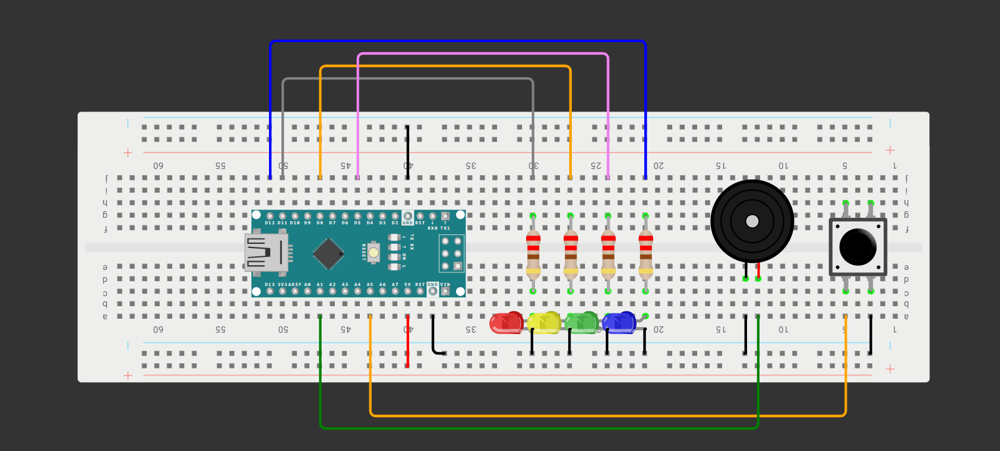

# Lucky Slot Machine
A lucky slot machine using four LEDs, a passive buzzer, and a pushbutton.

---

## 🚀 How It Works

The LEDs and buzzer flash and tone. When it's finished, the player must replicate the exact pattern using the pushbuttons. The Arduino randomly chooses the pattern in which the LEDs flash, and each LED has a unique tone. If the player fails to replicate the pattern, they must start over. If they reach the maximum number of levels, they win.

### Hardware
- **Development Board:** Arduino Nano
- **Main Components:** Passive Buzzer + LEDs
- **Software:** Arduino IDE

### Cool Features
- Random flashing + sound effects
- Flashing slowing down (simulating a real slot machine)
- Portability
- Amplified sound (using transistor and diode)

---

## 📊 Circuit Layouts

### Wiring Diagram

Below is the wiring diagram for the project:

**Note: This wiring diagram was made in Wokwi. Since Wokwi doesn't have a Power MB V2, transistor, or diode in the actual build, the wiring diagram is an approximation of the physical build but retains the correct wiring and functionality.**

### Schematic

Below is the schematic generated in Tinkercad:

*Schematic coming soon*

## 🔗 Wokwi Simulation
Try the interactive simulation of the project here:

[Open in Wokwi](https://wokwi.com/projects/478240792839430145)

---
## 🖼️ Project Photo

See the project (may have some issues viewing it on desktop):

[Click here](Lucky_Slot_Machine_Image.png)

## 🎥 Video Demonstration

Watch the project in action + an explanation of the build:

[▶ Watch the Video](NOT_READY_YET)

---

## 📁 Repository Contents

- `Lucky_Slot_Machine.ino` — Arduino source code
- `README.md` — Project documentation
- `LICENSE` — Apache License 2.0
- `Lucky_Slot_Machine_Image.png` — Project photo
- `Lucky_Slot_Machine.png` — Wiring Diagram 
- `Schematic.png` — Coming Soon!

---

## 🛠️ Components Used

- Arduino Nano Board
- Passive Buzzer
- 4 LEDs
- Pushbutton
- Transistor
- Diode
- Resistors
- Power MB V2 + 9V Battery
- Jumper wires

---

## 💡 What I Learned

I learned to go back and make my games playable. Since my original code contained 100 max levels of play, which is nearly impossible, I had to go back and reduce it to a manageable amount. Therefore, I think this project has demonstrated my ability to go back and reanalyze my build.

I also learned how to amplify buzzer sound; with an S8050 transistor, 1KΩ Resistor, and a IN4001 Diode. Before, I thought the sound of my passive buzzer was too small, so using the components in my kit, I was able to conjure up this sound amplifier that now makes the buzzer sound way louder.

---

## 📜 License

This project is licensed under the Apache License 2.0.
